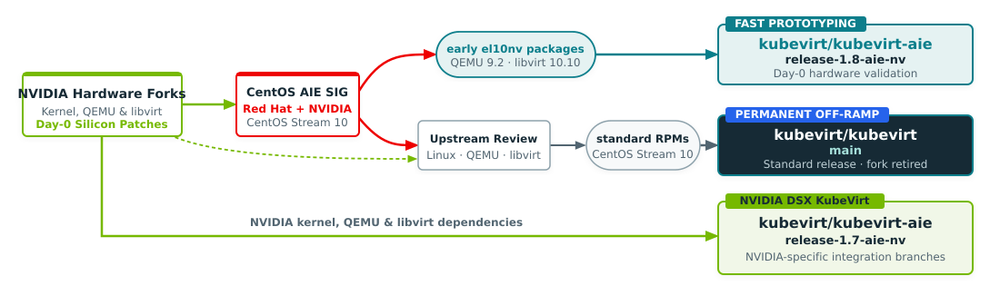

# KubeVirt AIE

**KubeVirt Accelerated Infrastructure Enablement (AIE)** brings support for emerging accelerated infrastructure to [KubeVirt](https://github.com/kubevirt/kubevirt). It provides release-based integration branches where contributors can develop and validate hardware enablement while preparing changes for upstream inclusion.

The initial focus is NVIDIA ARM64 virtualization, including GPU passthrough on Grace Hopper, Grace Blackwell, and Vera Rubin. Available capabilities depend on the selected branch and its kernel, QEMU, and libvirt dependencies. See the branch documentation for platform requirements and validation status.

## Why KubeVirt AIE ?

Hardware enablement often requires coordinated changes across the Linux kernel, QEMU, libvirt, KubeVirt, and Kubernetes. These changes can become available at different times and may require integration and testing before they reach standard releases.

Accelerated platforms also introduce requirements such as large PCI BARs, coherent device memory, accelerated IOMMUs, and complex CPU, GPU, and NIC topologies. Supporting these systems can require changes to both the virtualization stack and how KubeVirt constructs and manages virtual machines.

KubeVirt AIE provides a shared place to integrate this work, test complete configurations, and develop changes with a path upstream. It works alongside the [CentOS Accelerated Infrastructure Enablement SIG](https://sigs.centos.org/aie/), which develops kernel and virtualization-stack.

Red Hat and NVIDIA collaborate through KubeVirt WG AIE and the CentOS AIE SIG to coordinate hardware enablement across the virtualization stack. CentOS AIE packages and NVIDIA development branches provide different dependency paths for integration and validation. KubeVirt AIE brings this work together around shared requirements, testing, and contributions to upstream KubeVirt.



*The diagram shows the intended collaboration and integration paths.
Feature availability and validation status depend on the selected branch and dependency stack.*

The [WG AIE](https://github.com/kubevirt/community/tree/main/wg-aie) requires that changes carried in this fork are upstreamed back into [kubevirt/kubevirt](https://github.com/kubevirt/kubevirt) as soon as possible. Retiring this fork requires upstreaming at two levels: the el10nv RPM patches must be integrated into the main CentOS Stream 10 repositories by the AIE SIG, and the broader [CentOS Stream 10 transition (VEP #210)](https://github.com/kubevirt/enhancements/issues/210) must land in KubeVirt (planned across v1.9-v1.11). Only once both are complete can the standard KubeVirt `virt-launcher` build include the necessary hardware enablement and this fork be retired.


**Chairs:**

- [Lee Yarwood](https://github.com/lyarwood), Red Hat
- [Fan Zhang](https://github.com/fanzhangio), NVIDIA

**Meetings:**

- Fortnightly on Thursdays at 15:00 UTC
- [Zoom link](https://zoom-lfx.platform.linuxfoundation.org/meeting/98466361192?password=8b5bb80a-9770-4d90-87e7-c6addb598c7f)
- [Meeting notes](https://docs.google.com/document/d/1Tz7GubzbSOliRv2kFXamVhV66v1Wo9HH9hwwRQVYrDk)

## CentOS Stream AIE SIG

This work is aligned with the [CentOS Accelerated Infrastructure SIG](https://sigs.centos.org/aie/), which produces the el10nv RPM variants of libvirt and QEMU in CentOS Stream 10. The AIE SIG focuses on enabling accelerated and heterogeneous computing infrastructure, with packages optimised for NVIDIA hardware available from [CentOS Stream 10 koji](https://kojihub.stream.centos.org). WG AIE coordinates the integration of these packages into the KubeVirt ecosystem. For more information on the broader CentOS AIE SIG initiative, see the [CentOS Accelerated Infrastructure SIG documentation](https://docs.centos.org/centos-accelerated-infrastructure-sig/).

## Scope and release branches

AIE branches track selected upstream KubeVirt releases and carry the changes needed for their hardware enablement goals.

Depending on the branch, these changes can include:

- QEMU and libvirt package integration.
- Alternative `virt-launcher` images.
- KubeVirt device assignment and domain configuration changes.
- Supporting deployment components and validation tools.

Some branches provide an alternative `virt-launcher` image for use with an otherwise standard KubeVirt release. Branches that change other KubeVirt components require the corresponding component images.

Use the build and deployment instructions for the selected branch. Do not assume that launcher images, component images, or virtualization packages are interchangeable across branches.

## Virtualization dependencies

CentOS Stream AIE provides a path for integrating hardware enablement into the CentOS Stream ecosystem. AIE configurations can use NVIDIA-enabled QEMU and libvirt packages, inlcuding [CentOS Accelerated Infrastructure SIG](https://sigs.centos.org/aie/), particular the `el10nv` variants.

Development configurations may also use packages built from dedicated branches of [NVIDIA QEMU](https://github.com/NVIDIA/QEMU) and [NVIDIA libvirt](https://github.com/NVIDIA/libvirt). These configurations require a compatible host kernel and platform setup.

The branch documentation should identify the package sources, required versions, and tested configurations. The presence of a feature in source code or an RPM does not establish that the complete configuration has been validated.

## Related components

The AIE ecosystem includes supporting projects for launcher selection, IOMMUFD access, and deployment integration. The components required depend on the selected configuration.

| Component | Purpose |
| :--- | :--- |
| [KubeVirt AIE](https://github.com/kubevirt/kubevirt-aie) | Integrates KubeVirt changes and virtualization dependencies for accelerated infrastructure. |
| [AIE webhook](https://github.com/kubevirt/kubevirt-aie-webhook) | Supports launcher image substitution and admission-time configuration for AIE deployments. |
| [IOMMUFD device plugin](https://github.com/kubevirt/iommufd-device-plugin) | Opens and configures an IOMMUFD on the host and passes its file descriptor to `virt-launcher`. |
| [HyperConverged Cluster Operator](https://github.com/kubevirt/hyperconverged-cluster-operator) | Provides operator-managed integration for OpenShift Virtualization deployments. |

Design proposals are maintained in [kubevirt-aie-veps](https://github.com/kubevirt/kubevirt-aie-veps).

## Upstream direction

The goal is to make these capabilities available through standard KubeVirt releases and their supported dependencies.

This requires work at several levels:

- Contribute kernel, QEMU, and libvirt changes to their respective upstream projects.
- Integrate the necessary packages into standard CentOS Stream.
- Contribute reusable KubeVirt capabilities, tests, and documentation upstream.

Changes carried by AIE should have a clear upstream plan. Branch-specific patches can be removed as equivalent capabilities become available in the upstream release and dependency stack.

The [CentOS Stream 10 transition proposal](https://github.com/kubevirt/enhancements/issues/210) is part of this dependency alignment. Retirement of an AIE branch depends on its remaining changes and dependencies being available upstream, rather than on a fixed release date alone.


## What this fork changes

The delta against the upstream `release-1.8` branch is intentionally small:

- **NV RPM sync infrastructure** (`hack/sync-nv-rpms.sh`) -- Automated discovery and download of el10nv RPMs from CentOS Stream 10 koji
- **WORKSPACE and rpm/BUILD.bazel updates** -- Bazel build definitions for the el10nv RPM packages
- **CentOS Stream 10 builder** (`hack/builder/Dockerfile.cs10`) -- Build toolchain for multi-architecture (x86_64, aarch64) image builds
- **WIP image push script** (`hack/push-virt-launcher-pr.sh`) -- Convenience script for building and pushing images from feature branches

## Quick start

### Syncing NV RPMs

```shell
# Auto-discover latest el10nv versions from koji
hack/sync-nv-rpms.sh

# Override specific versions
LIBVIRT_NV_VERSION=11.10.0 QEMU_NV_VERSION=10.1.0 hack/sync-nv-rpms.sh
```

### Building and pushing a WIP virt-launcher image

```shell
# Push from current branch with auto-generated tag
hack/push-virt-launcher-pr.sh

# Override registry and tag
DOCKER_PREFIX=quay.io/myorg DOCKER_TAG=test-1 hack/push-virt-launcher-pr.sh
```

### Building release images

```shell
DOCKER_PREFIX=quay.io/kubevirt/kubevirt-aie \
DOCKER_TAG=v1.8.0-aie-nv \
BUILD_ARCH=amd64,crossbuild-aarch64 \
make bazel-push-images
```

## Upstream KubeVirt

This fork is based on [KubeVirt](https://github.com/kubevirt/kubevirt), a virtual machine management add-on for Kubernetes. For general KubeVirt documentation, see:

- [KubeVirt user guide](https://kubevirt.io/user-guide)
- [KubeVirt architecture](https://github.com/kubevirt/kubevirt/blob/main/docs/architecture.md)
- [KubeVirt API reference](https://kubevirt.io/api-reference/)

## Community

- [CentOS Accelerated Infrastructure SIG](https://docs.centos.org/centos-accelerated-infrastructure-sig/) -- Upstream SIG producing the el10nv RPM variants
- [KubeVirt Slack](https://kubernetes.slack.com/?redir=%2Farchives%2FC8ED7RKFE) -- `#virtualization` on kubernetes.slack.com
- [kubevirt-dev Google Group](https://groups.google.com/forum/#!forum/kubevirt-dev)

## License

KubeVirt is distributed under the
[Apache License, Version 2.0](http://www.apache.org/licenses/LICENSE-2.0.txt).

    Copyright The KubeVirt Authors.

[//]: # (Reference links)
   [k8s]: https://kubernetes.io
   [crd]: https://kubernetes.io/docs/tasks/access-kubernetes-api/extend-api-custom-resource-definitions/
   [libvirt]: https://www.libvirt.org
